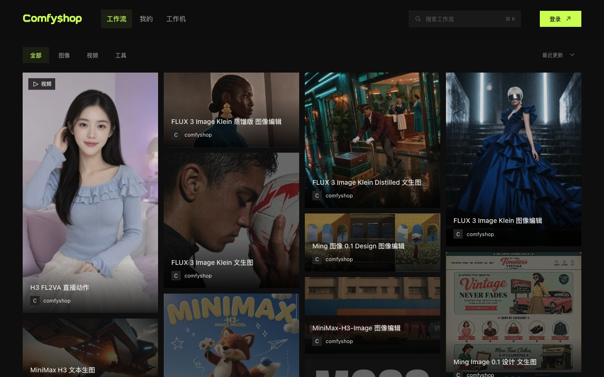
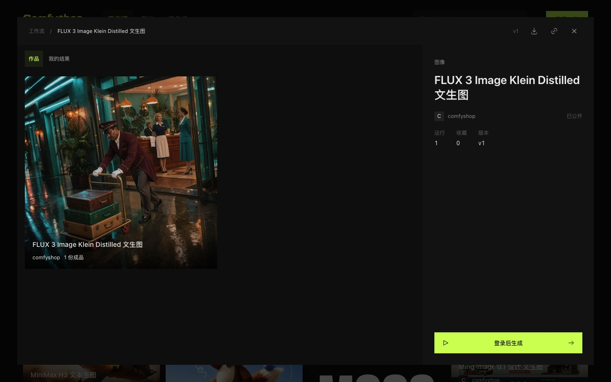
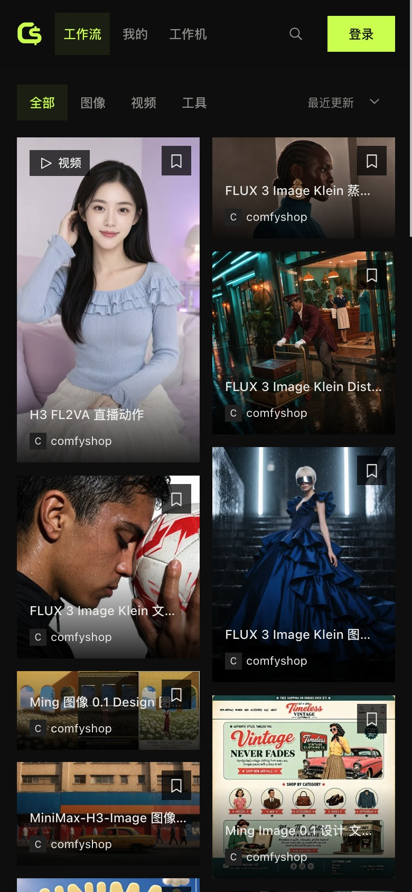
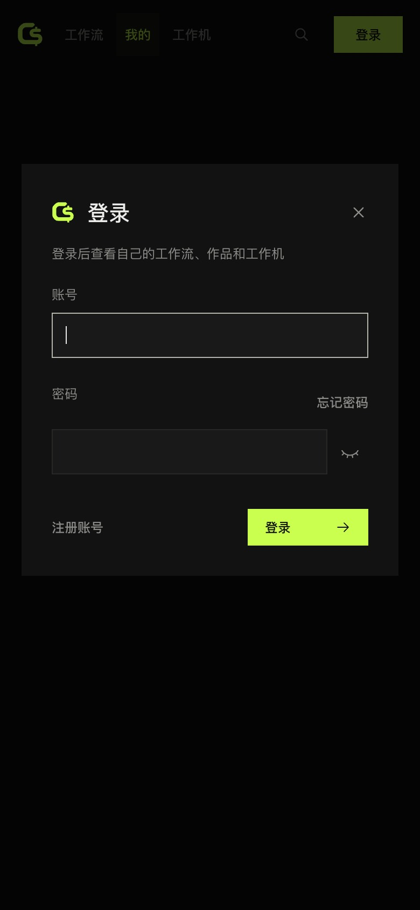

# ComfyShop

[简体中文](README.md) · **English**

<p>
  
  
</p>

**An open-source, self-hosted alternative to [runninghub.ai](https://www.runninghub.ai/) for ComfyUI teams.**

Turn ComfyUI workflows your team has tuned into forms colleagues can use from a browser. Submit image and video generation jobs, follow each execution, download the original outputs, and reuse settings from earlier runs. Generation runs on GPU workers connected by each account. The database and media live on the infrastructure where you deploy ComfyShop.

[Docker quick start](#docker-quick-start) · [Screenshots](#screenshots) · [Worker setup (Chinese)](integrations/comfyui/README.md) · [GitHub Issues](https://github.com/ComfyShop-ORG/ComfyShop/issues)

[](https://github.com/ComfyShop-ORG/ComfyShop/actions/workflows/ci.yml) · [MIT License](LICENSE)



## From workflow to output

1. **Publish workflows your team can reuse.** Export an API JSON file from ComfyUI and import it into ComfyShop. The author can organize form fields, add hints, and set defaults. A workflow version becomes eligible for publication after a successful execution. The author can keep editing a separate draft.
2. **Submit generation jobs from the browser.** Pick a workflow, enter prompts and reference media, and select one of your connected workers. The worker claims the queued job and reports progress and errors as it runs.
3. **Track every execution.** A job can run more than once. Each execution records its workflow version, actual inputs, seed when applicable, and original outputs. In **My Workspace → Results (我的 → 结果)**, completed executions remain available if a later run in the batch fails. Load settings from a past execution to run it again.
4. **Share selected work.** Select outputs and a cover from a successful execution, then choose whether to share its editable parameters. Visitors can view the selected outputs using the work's shareable link. Reference inputs stay private.

[Detailed product behavior (Chinese)](docs/requirements.md)

## Get started

### Docker quick start

Install Docker and Docker Compose on the machine that will host the platform.

```sh
git clone https://github.com/ComfyShop-ORG/ComfyShop.git
cd ComfyShop
docker compose up -d --build --wait
```

The current web interface is in Simplified Chinese. The steps below include the labels shown in the app.

1. Open ComfyShop and choose **Log in → Sign up (登录 → 注册账号)** to create an account. If the platform and worker run on the same machine, you can open `http://localhost:8688` on that machine. For a separate worker, open the site at a server IP address or domain the worker can reach.
2. Open **Work Machines (工作机)** and download the worker package. The bundled `worker.json` uses the platform address from the download request by default. Set `COMFYSHOP_PUBLIC_URL` on the server to specify the platform's external address. Extract and start the package on a GPU machine already running ComfyUI, then approve the connection in the browser.
3. Import a **ComfyUI API JSON** file under **My Workspace → Workflows (我的 → 工作流)**. Select a worker and submit a job. Open **My Workspace → Results (我的 → 结果)** to view or download the original outputs.

A fresh instance starts with an empty library. The default Compose stack keeps SQLite and media in the volume mounted at `/data`. The team stack uses PostgreSQL and can store media locally, in RustFS, or in an external S3-compatible bucket. Anyone who can reach the instance can browse public workflows and published work. For team-only use, put the instance on a private network or behind an access-controlled gateway. [Ports, HTTPS, and backups (Chinese)](docs/deployment.md)

### Local development

Use Node.js 22.13 or later in the 22.x line, or Node.js 24 or later. You also need pnpm 12.21.0, uv, and the Python 3.12 version specified in `.python-version`. Install `ffmpeg` and `ffprobe` to process video with the local API or run video-related tests.

```sh
pnpm install --frozen-lockfile
uv sync --all-packages --locked
pnpm dev
```

The default development web address is `http://127.0.0.1:5173`. API documentation is at `http://127.0.0.1:8688/docs`. To run the production build locally, run `pnpm build` followed by `pnpm start`.

## Screenshots

### Desktop workflow and published work



### Mobile

|                                        Public workflow library                                        |                                            Sign-in dialog                                            |
| :---------------------------------------------------------------------------------------------------: | :--------------------------------------------------------------------------------------------------: |
|  |  |

## Connect GPU workers

The worker runs as a standalone process or as a ComfyUI plugin. Install the required models and custom nodes in the ComfyUI environment that will execute the workflow. Each account can connect multiple workers and choose which one runs a job. [Installation, manual pairing, and recovery (Chinese)](integrations/comfyui/README.md)

## Use the Skill

Open **Account → Install Skill (账户 → 安装 Skill)** or visit `/skill` on your instance to configure Codex or Claude Code. The Skill signs in separately with the same account permissions. It can find workflows, prepare multiple input sets, submit jobs, and retrieve outputs. Each distinct input set is queued as a separate job. [Skill instructions (Chinese)](integrations/skills/comfyshop/SKILL.md) · [Platform commands (Chinese)](integrations/skills/comfyshop/references/operations.md)

## Data and migrations

See `.env.example` for available settings and data locations. Back up your data volume before updating. The production startup command applies Alembic migrations. [Deployment and backups (Chinese)](docs/deployment.md) · [Example environment configuration](.env.example)

## Project layout and checks

| Directory      | Contents                                              |
| -------------- | ----------------------------------------------------- |
| `apps/web`     | React interface                                       |
| `apps/api`     | FastAPI, job and access rules, and Alembic migrations |
| `packages`     | Typed API client, UI components, and design tokens    |
| `integrations` | ComfyUI worker and Skill for external clients         |

```sh
pnpm check
pnpm format:check
pnpm test
pnpm build
```

GitHub Actions also checks that the generated OpenAPI contract is current and that the database models match the migrations. [Architecture (Chinese)](docs/architecture.md) · [Design system (Chinese)](docs/design-system.md) · [Verification guide (Chinese)](docs/verification.md) · [CI workflow](https://github.com/ComfyShop-ORG/ComfyShop/actions/workflows/ci.yml)

## License

ComfyShop is distributed under the MIT License. [LICENSE](LICENSE)
