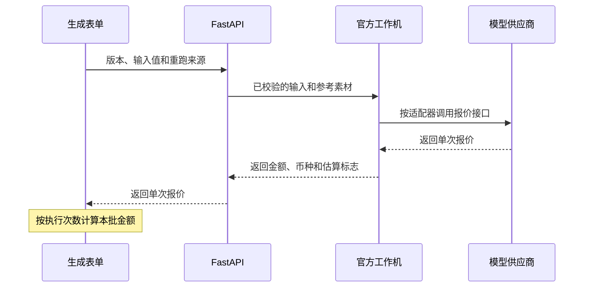
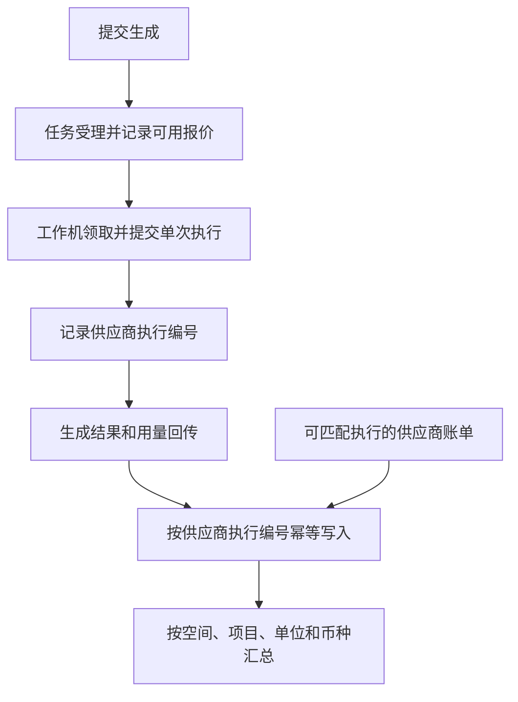

# 官方模型用量估算扩展

## 当前报价链路

个人和团队从同一个生成表单调用 `POST /api/v1/tasks/cost-estimate`。FastAPI 校验工作流版本、表单哈希、重跑来源、空间权限和素材归属。官方工作机按 `execution.adapter` 调用报价适配器，使用执行对应的供应商计费账号。

`CostEstimate` 返回单次金额 `unitPrice`、币种 `currency` 和按用量估算标志 `estimated`。网页用单次金额乘以执行次数。报价响应随当前表单显示，点击「生成」才创建排队任务。带私有参考素材的报价由用户点「估算费用」发起。 [报价架构](architecture.md#任务提交与取消) · [官方工作机部署](deployment.md#官方工作机)

外部客户端可以通过 Skill 的 `call task.cost-estimate` 访问同一入口。 [Skill 报价用法](../integrations/skills/comfyshop/references/generation.md#查询预计费用)



## 增加用量字段

扩展报价响应时，保留 `CostEstimate` 的三个字段，按需增加 `usage`。用量项包含单位、十进制数量和来源。数量以字符串传输，方便复用现有的精确金额计算方式。供应商缺少用量明细时可以省略该字段。

| 单位           | 可用的估算依据               | 结算时的用量依据       |
| -------------- | ---------------------------- | ---------------------- |
| 生成次         | 冻结的每次执行参数           | 供应商执行回执         |
| 图片张数       | 请求的输出张数               | 供应商确认的计费张数   |
| 视频或音频秒数 | 请求时长和适用的参考素材时长 | 供应商确认的计费时长   |
| 文本字符数     | 按模型规则处理后的文本长度   | 供应商确认的计费字符数 |
| Token          | 供应商报价响应中的估算量     | 供应商返回的计费用量   |
| 积分           | 当前参数对应的供应商积分报价 | 供应商结算的积分       |

同一种单位在不同供应商可能有不同口径。Token 用量保留供应商、模型及其方向或类别。汇总按计费口径和币种进行。积分可以作为用量展示，有可核对的账号积分价格时可以提供金额换算。带来额外计费的参考素材应按适配器规则进入报价请求。

下方 JSON 是拟扩展的响应示例，金额和数量为示意值。`usage` 描述一次执行。

```json
{
  "unitPrice": "1.62",
  "currency": "USD",
  "estimated": true,
  "usage": [
    { "unit": "video_second", "quantity": "10", "source": "workflow" },
    { "unit": "video_token", "quantity": "486000", "source": "provider" }
  ]
}
```

Atlas Cloud 的 `/calculate` 提供折扣后价格，部分按 Token 计费的模型会返回 `estimated_tokens`。参考生视频的估算可能取决于输入视频时长。接入用量字段时可先映射该值，保留供应商报价的计量口径。 [Atlas Cloud 计费说明](https://www.atlascloud.ai/docs/billing/model-billing#estimating-cost-before-you-generate)

## 接入新的供应商

1. **注册适配器。** 在官方工作机启动处把报价函数登记到对应的 `execution.adapter`。函数接受通用的 `QuoteRequest` 和已授权素材，返回统一报价。 [适配器注册](../integrations/official-worker/comfyshop_official_worker/__main__.py) · [报价契约](../integrations/official-worker/comfyshop_official_worker/quotes.py)
2. **复用生成请求。** 用实际提交使用的模型、默认值和素材映射构建报价请求。可影响价格的分辨率、时长、生成数量及其他选项以供应商定义为准。报价和执行使用同一个计费账号。
3. **确认批次算法。** 每次执行使用同一计价参数且按次计费时，可以复用单次报价乘以执行次数。供应商按整个批次计费时，扩展接口交由适配器返回该批次的报价。
4. **处理报价失败。** 供应商暂无报价时显示「暂无法估价」，提供重试。用户可以继续生成。测试覆盖固定价、按用量计价、报价超时以及切换版本或素材后的刷新。

供应商只提供费率表时，可用有明确生效时间的费率和可计算的用量生成估算。记录费率来源及版本。账号折扣只有在可核对时才计入报价。

## 计划中的实际用量回传

将实际用量绑定到单次执行，沿用任务的空间、项目和提交人归属。任务受理时可保存与本次提交匹配的报价快照，记录计费参数摘要、金额和报价时间。工作机取得供应商执行编号后，按现有租约与执行回传流程补录已确认的用量。对同一个供应商执行的续查、接管和重复回传共用计费记录。



- 以供应商、计费账号标识和供应商执行编号识别一笔执行。确认重新提交并获得新执行编号后，记录新的用量。供应商受理状态未确认时，沿用现有核对流程。
- 实际扣费以可匹配执行的供应商回执或账单为准。金额未确认时保留待确认状态，零费用使用供应商明确给出的值。失败、取消、退款和延迟结算各按供应商回执更新。
- Atlas Cloud 的用量和成本查询提供按天汇总，可用于核对账号或模型总额。逐次归属需要能与供应商执行编号关联的计费数据。 [Atlas Cloud 用量与成本接口](https://www.atlascloud.ai/docs/public-api#usage-and-cost-query-parameters)
- 回传和报表沿用空间权限。持久化记录保存计量数据、来源和执行关联。处理报价时用到的供应商密钥和临时素材地址留在服务端。

## 落地顺序

1. 为报价响应增加可选用量明细，先用 Atlas Cloud 的 Token 估算验收。用文生、图生和参考生视频对照供应商报价，检查个人和团队空间及桌面和窄屏。
2. 接入可验证的单次执行用量回传。用重试、断线接管、部分成功、取消和延迟结算覆盖去重及状态更新。已存在的任务按可用的历史记录展示。
3. 用可核对的逐次数据汇总项目和团队用量。提供计量单位与币种筛选，并按数据覆盖情况标明仍待确认的执行。
